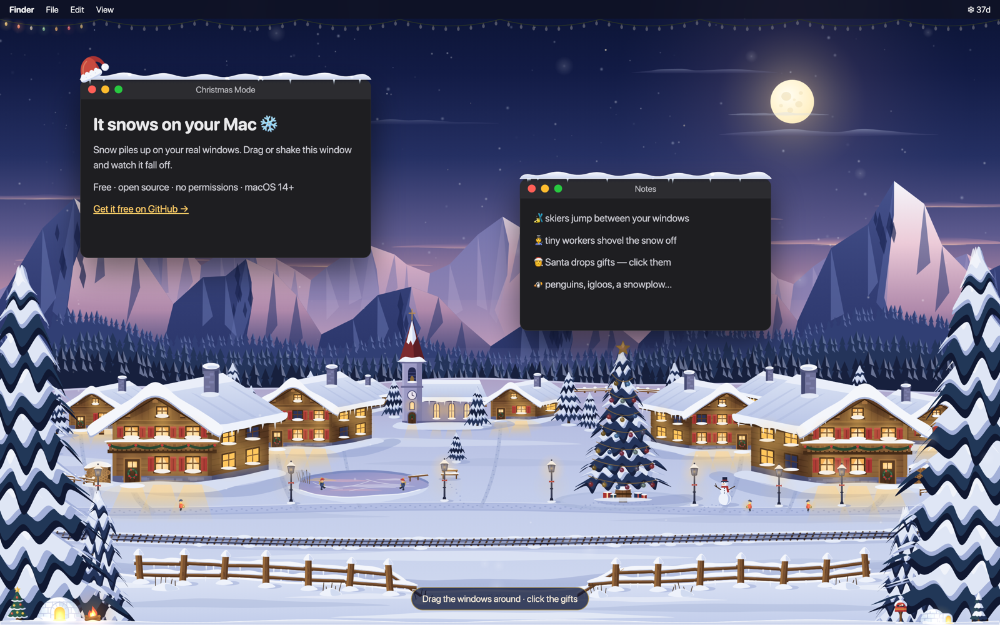

# ❄️ Christmas Mode

**Dark Mode. Light Mode. Christmas Mode.**
It snows on your whole Mac — and the snow **piles up on your real windows**. Shake a window and it all falls off.



**[▶︎ Try it in your browser](https://romainsildev.github.io/christmas-mode/)** — drag the windows around.

## Install

```bash
curl -fsSL https://raw.githubusercontent.com/romainsildev/christmas-mode/main/install.sh | bash
```

The one-liner installs to /Applications and opens the app — no Gatekeeper prompt.

Prefer a download? Grab `ChristmasMode.zip` from [Releases](https://github.com/romainsildev/christmas-mode/releases) and drag the app to Applications. The app is free but not notarized yet, so the first time macOS will refuse to open it: go to **System Settings → Privacy & Security** and click **Open Anyway** (or run `xattr -dr com.apple.quarantine "/Applications/Christmas Mode.app"`).

macOS 14 Sonoma or newer · Apple silicon & Intel · 1.4 MB download · free & open source

## What it does

- ❄️ **Snow over everything** — clicks go straight through, nothing gets in your way
- 🪟 **Snow piles up on top of your real windows**, with icicles. Drag or shake a window and it falls off; close it and the pile collapses
- 📱 **Your MacBook notch becomes a snow cannon** — and Santa's sleigh takes off from it
- 🎿 Skiers jump from window to window (and sometimes wipe out)
- 🧑‍🏭 Tiny shovelers rappel down from the menu bar to clear your windows
- 🚜 A snowplow clears the bottom of your screen
- 🎅 Santa flies by and drops gifts — **click them**
- 🐧 Penguins (click them too), igloos, a campfire, kids rolling snowmen
- 🏔️ An animated cozy village wallpaper — chimney smoke, skaters, a little train
- 💡 Christmas lights under the menu bar and a countdown to Christmas
- 🔴 Optional Christmas-red macOS accent color — put back exactly as it was when you turn it off
- 🔔 Sleigh bells when you switch it on, optional music box — mute both in *Sound*

## Use

- **Click ❄️** in the menu bar for the settings panel · **right-click** to switch it on/off · **⌃⌥N** anywhere
- **Party** mode: more characters, Santa every ~20 s — perfect for screen recordings
- **Hide desktop icons** in *Vibes* for clean recordings

## Privacy & performance

No network access, no analytics, **no permissions** (no Screen Recording, no Accessibility). Window positions are read locally, only to know where to pile the snow.
About 3 % CPU on an M-series Mac at 30 fps; everything pauses when the screen sleeps or locks.

## Uninstall

If you enabled **Open at login**, switch it off first. Then click ❄️ → **Quit** (your accent color goes back to what it was) and delete *Christmas Mode.app*.

## Build from source

```bash
git clone https://github.com/romainsildev/christmas-mode.git && cd christmas-mode
scripts/build.sh --install        # → /Applications/Christmas Mode.app
swift test && node --test tests/*.test.js
```

Swift 6 · AppKit + SwiftUI · a small canvas engine in WKWebView.

## How it works

A menu-bar app opens two transparent, click-through windows per screen: one at desktop level for the animated wallpaper, one above everything for the snow. Every 1/30 s it reads the frames of your app windows (`CGWindowListCopyWindowInfo`, no permission needed) and sends them to the engine, which keeps a height map of snow on each window's top edge — so piles move with the window, hide behind windows in front of them, and fall off when the window moves too fast.

## Credits

Built with [Claude Code](https://claude.com/claude-code); the illustrations were drawn as SVG by AI design agents and hand-picked. MIT license.

Found a bug? Open an issue and attach `~/Library/Logs/ModeNoel.log`.
